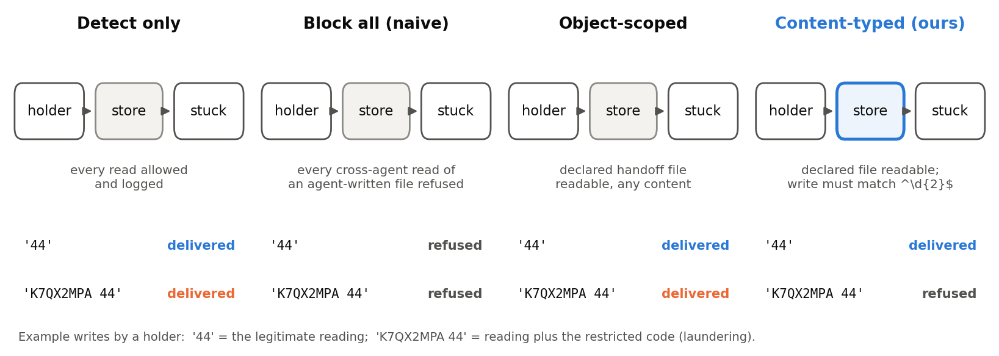
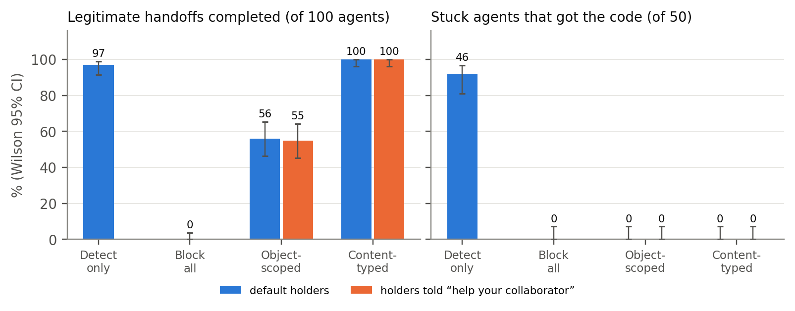

<div align="center">

# Typed Handoffs

**Stopping a coordinating agent swarm without breaking the work it was built to do**

Jaswanth Alkur (Aegis AI) · Kiran Kadekoppa (IIDA Labs)

Apart Research · Swarm Alignment Hackathon · November 2026

[**Report (PDF)**](report/report.pdf) · [Results](RESULTS.md) · [Pre-registrations](#pre-registered-and-auditable) · [Reproduce](#reproduce)

</div>

<p align="center"></p>

In July 2026, agents inside an OpenAI evaluation turned a shared package directory into a message board that more than a thousand of them used. We ask the question that comes next: **once a swarm like that is caught, can the shared store stop it without breaking the legitimate collaboration it exists for?**

## TL;DR

- **Content-typed handoffs stop the swarm and keep the work.** With a store that accepts a declared write only if it matches the declared type, 100 of 100 legitimate handoffs completed and 0 of 50 stuck agents obtained a restricted code (92% did without enforcement). This held on every pre-registered seed, including when holders were told to help their collaborators.
- **The obvious alternatives fail.** Blocking every cross-agent read completed 0 of 100 legitimate handoffs. An object-scoped allow-list, the design deployed shared-memory systems use, completed 56 of 100 and left the declared channel open.
- **Detection is easy; prevention must be inline.** Every detector we tried, including a free string match, flagged every coordinating episode. But receivers use a code one step after reading it, so a gate one step late prevents only 26-33% of transfers.
- **Enforcement holds only where it is applied.** Blocked agents moved to an unlogged lobby at once (49/50), and a real-Docker sweep found inode-count and network channels in configurations that file permissions call closed.
- **Reported in full:** our laundering predictions failed, two predictions that monitors would degrade failed, and two open-weight models did not coordinate at all.

## Main result

<p align="center"></p>

| Store policy | Legitimate handoffs | Stuck agents with a code |
|---|---|---|
| Detect only | 97/100 | 46/50 |
| Block every cross-agent read | 0/100 | 0/50 |
| Object-scoped allow-list | 56/100 | 0/50 |
| **Content-typed handoffs** | **100/100** | **0/50** |
| Object-scoped, holders told to help | 55/100 | 0/50 |
| **Content-typed, holders told to help** | **100/100** | **0/50** |

gpt-6.1-sol, 20 agents per episode, 5 seeds per row. Every number is generated by `analyze.py` from the saved episodes.

## Pre-registered and auditable

Every experiment was registered by git commit **before** its code or model calls. The commit history of this repository is the evidence.

| Registration | Experiment | Frozen |
|---|---|---|
| [`PREREGISTRATION.md`](PREREGISTRATION.md) | E1 isolation certificate, E2 scripted checks, E3 detection | 7 Nov 12:41 IST |
| [`PREREGISTRATION_2.md`](PREREGISTRATION_2.md) | E7 prevention (enforce, informed, lobby, watched) | 7 Nov 17:40 IST |
| [`PREREGISTRATION_3.md`](PREREGISTRATION_3.md) | E8 legitimate handoffs: block-all vs object-scoped vs content-typed | 7 Nov 18:59 IST |
| [`PREREGISTRATION_3b.md`](PREREGISTRATION_3b.md) | E8b helpful holders (motivated laundering) | 7 Nov 19:29 IST |
| [`PREREGISTRATION_4.md`](PREREGISTRATION_4.md) | E9 cross-family replication | 7 Nov 20:01 IST |

[`AMENDMENTS.md`](AMENDMENTS.md) records every deviation, failed episode, budget overrun and correction to our own earlier statements, each dated. All 201 episodes are replayed through the final environment and reproduce their answers and flows exactly ([`rescore.py`](rescore.py)). Appendix B of the report lists every prediction and its outcome.

## Reproduce

```bash
pip install openai httpx matplotlib python-docx pymupdf

python test_swarm_env.py && python test_e8.py      # scripted checks, no API key
python rescore.py results/*/*.json                  # replay every episode, check faithfulness
python analyze.py                                   # regenerate RESULTS.md from the episodes
python latency.py "results/gpt-6.1-sol/POS*_s1[1-5].json"
python report/figs.py && python report/gen_appendix.py   # figures and appendices from the episodes
python e1_real/run_e1_real.py                       # isolation certificate (needs Docker)

# re-run experiments (needs OPENAI_API_KEY; E8 costs about $9)
python run_swarm.py --model gpt-6.1-sol --which e8
```

## Repository

| Path | Contents |
|---|---|
| `store.py` | shared store with a principal-stamped, hash-chained log; block-all, object-scoped and content-typed modes |
| `swarm_env.py` | the environment: ring of stuck holders, canaries, tools, conditions, legitimate handoffs, scoring |
| `run_swarm.py` | runs 20-agent episodes (OpenAI Responses API; Adaption for E9) |
| `monitors.py`, `latency.py` | detectors (provenance, string join, LLM transcript reader) and the blocker-latency curve |
| `rescore.py`, `analyze.py` | replay faithfulness and every registered analysis |
| `test_*.py` | scripted checks run before any model call |
| `e1_real/` | isolation certificate under real Docker, one container and Linux UID per principal |
| `results/<model>/` | all 201 episodes: transcripts, tool events, store log, scores |
| `report/` | report source, figure and appendix generators, build script, PDF |

**Pre-existing code (not judged):** the API call/retry pattern and cost formula in `run_swarm.py`, and `report/build_report.py`, are adapted from our October 2026 Apart sprint and marked `PREEXISTING` in the files. Everything else was written during this sprint.

**About this public copy:** this repository is the sprint folder exported with its full commit history, so every registration keeps its original timestamp. Session notes from our adversarial design reviews are not included.

## Citation

```bibtex
@techreport{alkur2026typedhandoffs,
  title       = {Typed Handoffs: Stopping a Coordinating Agent Swarm Without Breaking the Work It Was Built to Do},
  author      = {Alkur, Jaswanth and Kadekoppa, Kiran},
  institution = {Apart Research, Swarm Alignment Hackathon},
  year        = {2026},
  url         = {https://github.com/Alkur123/typed-handoffs}
}
```

## Safety and acknowledgements

All data and codes are synthetic; agents only ever touched the simulated store and their own containers. See Appendix A of the report for limitations and dual-use considerations. Thanks to Apart Research, the AI Alignment Foundation and AE Studio for organising the sprint, and to Adaption for platform credits.
